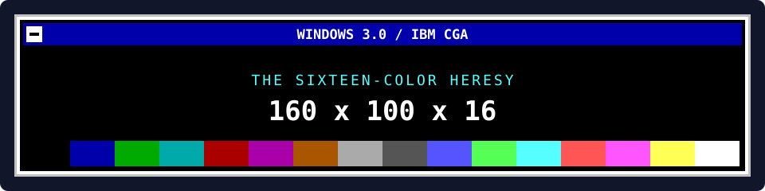
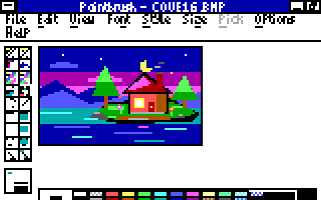
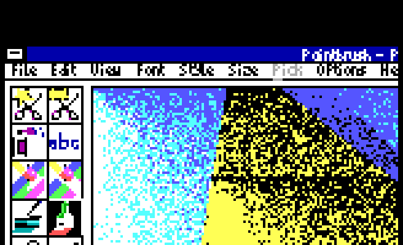
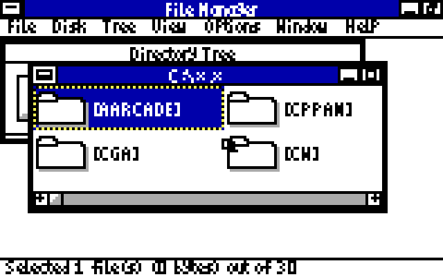
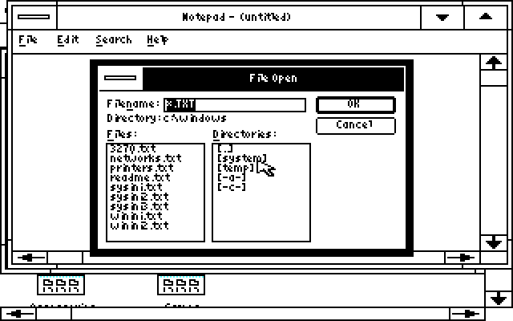
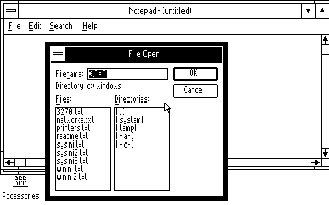

<p align="center">
  
</p>

<h1 align="center">Windows 3.0 on CGA</h1>

<p align="center">
  <strong>160 × 100 pixels. Sixteen RGBI colors. A compact Windows desktop.</strong>
</p>

<p align="center">
  <a href="https://github.com/astrobleem/oemdisplay-tandy/releases/download/windows-xt/CGA.ZIP"><strong>Download CGA.ZIP</strong></a> ·
  <a href="#get-it-running">Install</a> ·
  <a href="#how-it-works">How it works</a> ·
  <a href="https://github.com/astrobleem/oemdisplay-tandy/tree/main/src/cga">Driver source</a>
</p>

<p align="center">
  <a href="assets/PAINT100.PNG"></a>
  <br>
  <em>Paintbrush, meet CGA. The landscape itself uses all sixteen colors.</em>
</p>

The driver uses CGA's **text-mode circuitry** as a sixteen-color framebuffer
for Windows 3.0. Tiny bitmap fonts and compact
controls make room for actual windows on a screen just 100 pixels tall.

This repository is the CGA front door for
**[Windows XT / oemdisplay-tandy](https://github.com/astrobleem/oemdisplay-tandy)**.
The current driver, installation package, development and support live there.

## Get it running

You need an **IBM CGA-compatible RGBI display path**, an **installed Windows 3.0**
that can run in **real mode**, **DOS 3.3 or later**, and **640 KB of RAM**.
The qualification target is an IBM XT with a 4.77 MHz 8088 and IBM CGA.
You supply DOS and Windows; the download supplies the drivers, fonts,
grabber, artwork and helpers. Windows 3.1 is unsupported.

1. **[Download CGA.ZIP](https://github.com/astrobleem/oemdisplay-tandy/releases/download/windows-xt/CGA.ZIP)**
   and extract it. Keep root `SETUP.EXE`, `README.TXT` and the complete `CGA`
   folder together. Transfer that extracted folder to your DOS machine by your
   usual method.
2. Exit Windows completely. From the extracted folder, run:

   ```bat
   SETUP C:\WINDOWS 100
   ```

   Use your actual Windows directory. Wait for the success message; installation
   takes several minutes on a 4.77 MHz 8088.
3. Change to your Windows drive and directory, then start **`WIN /R`**.

That's the fixed 160 × 100 desktop. For a larger desktop, use `PAN` in place of
`100` during installation. Setup installs PAN automatically. A previous OFF
choice is preserved; run `PAN` inside Windows to enable it again.
Everything needed for installation runs on the DOS computer;
no Python, modern-PC preparation or individual support-file hunt is required.

**[Full CGA install guide](https://github.com/astrobleem/oemdisplay-tandy/blob/main/docs/CGA.MD)** ·
**[Current release and checksums](https://github.com/astrobleem/oemdisplay-tandy/releases/tag/windows-xt)**

## Choose a display mode

One download contains four choices. Exit Windows and rerun Setup to change modes.

| Setup choice | Windows desktop | What the CGA screen shows |
| --- | --- | --- |
| `100` | 160 × 100, 16 colors | The complete desktop, with compact fonts and controls |
| `PAN` | 320 × 200, 16 colors | A movable 160 × 100 viewport into the larger desktop |
| `320` | 320 × 200, 4 colors | Black, bright cyan, magenta and white |
| `640` | 640 × 200, 2 colors | Black and white |

### More desktop than screen

**Viewport panning is included in the current public package.** Install it with:

```bat
SETUP C:\WINDOWS PAN
```

In `PAN`, **Ctrl+Alt+arrows** moves the view, **Ctrl+Alt+Home** returns to the top
left, and **Ctrl+Alt+End** reveals the active window's bottom/right. Edge scrolling
and following the active window help reach controls outside the view. Queued
commands are applied after busy drawing finishes.

Open Panning settings with **Ctrl+Alt+S**, or run **`PAN /SETTINGS`** inside
Windows. Apply saves settings; Cancel discards unapplied edits. Horizontal steps
round up to multiples of eight pixels. See the
**[illustrated panning guide](https://github.com/astrobleem/oemdisplay-tandy/blob/main/docs/PANNING.MD)**.

In fixed `100` mode, those movement shortcuts move **windows and active client
contents** to expose hidden controls; the framebuffer remains 160 × 100.
Fixed `320` and `640` can opt into a window workspace through `PAN`.

<p align="center">
  
  <br>
  <em>Paintbrush on the larger desktop, viewed through the same little screen.</em>
</p>

## How it works

Ordinary CGA graphics offers 320 × 200 with four colors or 640 × 200 with two.
CGA text attributes, however, can select from the full **RGBI palette**: red,
green, blue and intensity.

The 160 × 100 driver programs the CRTC for **80 columns and 100 short character
rows**, with **two scanlines per row**. Every cell contains the right-half-block
character (`DEh`). Its background paints the left logical pixel; its foreground
paints the right. Disable blinking to make all sixteen background colors
available, and each cell becomes **two independently colored pixels**.

**80 × 2 = 160 pixels across. 100 rows = 100 pixels down. All sixteen colors.**

Windows draws through the display driver's four-plane shadow bitmap in RAM;
the driver converts the result into character/attribute pairs in CGA memory.
The color comes from RGBI text attributes, without composite artifact color.
VRAM accesses temporarily disable video to avoid CGA snow; visible blanking
and physical-card behavior still need hardware qualification.

For the details, follow the
[conversion implementation](https://github.com/astrobleem/oemdisplay-tandy/blob/main/src/cga/CGA100.PY),
[mode setup](https://github.com/astrobleem/oemdisplay-tandy/blob/main/src/cga/CGA100E.ASM)
and [implementation record](https://github.com/astrobleem/oemdisplay-tandy/blob/main/docs/QUAL/CGA/IMPLEMENT.MD).

## Tiny windows, real captures

| Notepad: a File Open dialog in 100 pixels | File Manager: a little room to browse |
| --- | --- |
| [](assets/OPEN100.PNG) | [](assets/FILE100.PNG) |

| Classic CGA: 320 × 200, four-color mode | 640 × 200, monochrome |
| --- | --- |
|  |  |

These are existing **native Windows emulator captures**. The fixed-mode images
are unretouched decodes of saved CGA video memory; the enlarged versions repeat
pixels. The panning image retains the emulator's frame and border. They are
not physical-hardware photographs. The Paintbrush landscape matches all 3,840
pixels of its input picture and uses all sixteen colors within the picture.
**[Capture provenance and originals](docs/CAPTURES.md)**.

## Experimental, with receipts

The recorded runs use **IBM XT/CGA emulation with 640 KB and CGA snow enabled**.
Coverage includes installation and recovery, compact dialogs, Paintbrush,
viewport boundaries, off-screen drawing and queued panning controls.
Physical cards, clone CRTCs and composite output remain unqualified; PCjr,
Tandy and EGA/VGA are separate targets. Extended characters in the compact
160 × 100 fonts currently use fallback boxes.

To undo, exit Windows and run this from the retained package folder:

```bat
SETUP UNDO C:\WINDOWS
```

Follow the package's `README.TXT` for recovery. The explicit `RESTORE` command
restores whole saved INIs and can lose later INI edits.

## Follow the wires

- **[Canonical source and support](https://github.com/astrobleem/oemdisplay-tandy)**
  — report problems and contribute driver changes there.
- **[CGA qualification records](https://github.com/astrobleem/oemdisplay-tandy/tree/main/docs/QUAL/CGA)**
  · [CGAPAN evidence](https://github.com/astrobleem/oemdisplay-tandy/tree/main/docs/QUAL/CGAPAN)
  · [Shared panning evidence](https://github.com/astrobleem/oemdisplay-tandy/tree/main/docs/QUAL/UPAN).
- **[Other hardware](https://github.com/astrobleem/oemdisplay-tandy/blob/main/docs/PLATFORM.MD)**
  — the rest of the Windows XT family.
- **[Component notices](https://github.com/astrobleem/oemdisplay-tandy/blob/main/src/cga/NOTICE.TXT)**
  — original fonts and helpers retain their licenses; adapted Microsoft/DDK
  components retain their own notices.
- **[Front-door verification record](docs/VERIFICATION.md)** — the source revision
  and public package checked for this page.

<p align="center"><strong>Windows 3.0. 160 × 100. Sixteen RGBI colors.</strong></p>
